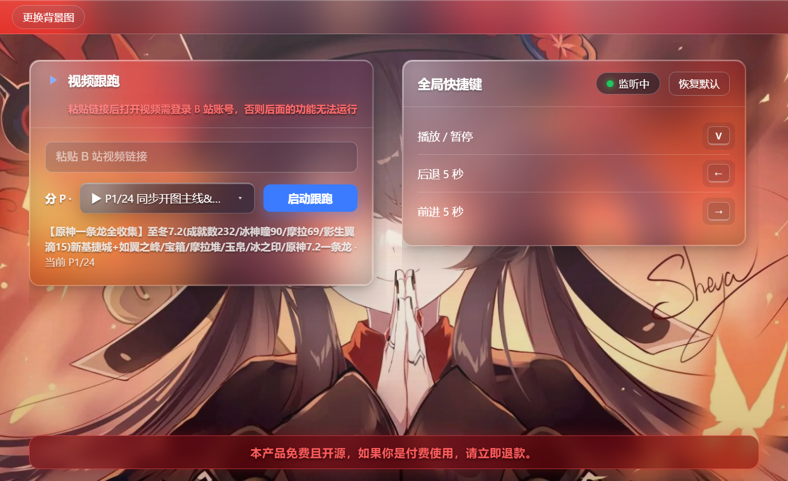
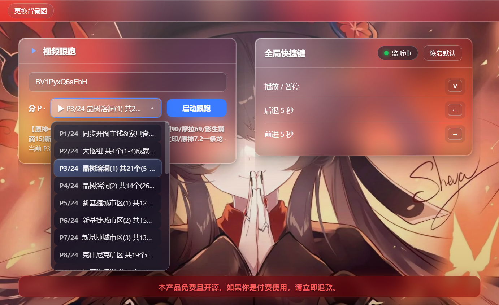

<div align="center">

# 胡桃助手 · Hu Tao Assistant

**把 B 站攻略视频钉在原神画面上，用全局热键控制播放。**

Windows 10 / 11 · x64 · Electron 45 · 免安装绿色版

[](../../releases/latest)
[](LICENSE)

</div>

---

## 这是什么

跑图时最烦的是「看攻略要切窗口」。胡桃助手把 B 站攻略视频做成一个**置顶小窗**压在游戏上层，
分 P 列表、热键控制都在启动器里，游戏不用退出、鼠标不用切走。

> 本项目由 [GIFA（原神跟跑助手）](https://github.com/FinalLawer/GIFA) 精简改造而来，
> 现在只保留两条主线：**视频播放** 与 **全局热键**。朝向识别、小地图标记等功能已移除，界面更干净、CPU 占用更低。

## 界面

| 启动器 | 分 P 玻璃下拉 |
| --- | --- |
|  |  |

## 功能

- **粘贴即播**：B 站视频链接粘贴进去，点「启动跟跑」就压在游戏上
- **分 P 双向联动**：启动器换 P，浮窗跟着换；浮窗里自己切 P，启动器下拉同步跟上
- **纯净播放**：自动清掉 B 站页面的推荐、弹幕、评论等干扰元素，只留播放器
- **全局热键**（对全屏游戏同样生效，需提权）：

  | 按键 | 作用 |
  | --- | --- |
  | `V` | 播放 / 暂停 |
  | `←` | 后退 5 秒 |
  | `→` | 前进 5 秒 |

- **液态玻璃界面**：分 P 下拉、卡片都是实时背景模糊，可换自定义背景图
- **绿色免安装**：不写注册表，数据都留在程序目录 `data\`

## 下载安装

1. 打开右侧 **[Releases](../../releases/latest)**，下载附件 `Hutao-Assistant-Setup-v1.0.exe`（显示名「胡桃助手-安装包」，约 84 MB）
2. 双击运行。安装包会自己完成：解压 → 清理旧版残留文件 → 创建桌面快捷方式 → 启动程序
3. 之后从桌面「胡桃助手」图标启动即可

安装包是 Windows 自解压格式 + LZMA2 载荷，自带解压器，**不需要 7-Zip**，默认解到
`桌面\胡桃助手-便携版\胡桃助手\`。下载后可自行改名为 `胡桃助手-安装包.exe`，不影响使用。

> 版本 1.0 · 安装包 87,965,696 B · MD5 `96d366c849c0d1876534d22e6a6b983b` · SHA-256 `3bfc286b…008aa29`

### 双击后闪退 / 起不来？

老显卡、虚拟机、部分笔记本（装有 GameViewer / MuMu 之类的虚拟显示适配器，或「Microsoft 基本显示适配器」报错）
会让 Electron 的 GPU 进程在初始化阶段直接崩（事件日志异常代码 `0x80000003`）。解决办法是带上三个参数启动：

```
胡桃助手.exe --in-process-gpu --disable-gpu-compositing --no-sandbox
```

安装包里的 `make-shortcut.ps1` 会自动检测显卡状态，遇到上述机器会**自动**把这三个参数写进桌面快捷方式；
想手动重建图标，双击程序目录里的 `创建桌面快捷方式.cmd`，或：

```powershell
powershell -ExecutionPolicy Bypass -File scripts\make-shortcut.ps1 -Launch
```

## 使用

1. 先点浮窗顶部的登录条，**登录 B 站账号** —— 未登录只能看预览/标清，后面分 P 和热键都会跑不动（启动器标题下也写了这条红字提醒）
2. 复制 B 站视频链接 → 粘到输入框 → 选分 P → **启动跟跑**
3. 回到游戏，用上表的热键控制播放

> 全局热键要对全屏游戏生效，需要程序以管理员权限运行（Windows UIPI 限制）。首次启动时如果提示提权，允许即可。

## 从源码运行

```bash
npm install
npm install --save-dev electron@45
npx electron .
```

打包成 asar（原生模块 `uiohook-napi` 保持在外，不能塞进 asar）：

```bash
npx @electron/asar pack . app.asar --unpack "**/node_modules/uiohook-napi/**"
```

## 目录结构

```
src/
  main.js              主进程：窗口、设置落盘、全局热键、IPC
  preload.js           启动器 preload（安全桥）
  hook-hotkeys.js      uiohook-napi 全局键盘钩子（配合 Electron globalShortcut 双通道）
  webview-preload.js   注入 B 站页面：纯净模式、视频接管、按键吞掉
  console/             启动器界面（HTML + 液态玻璃 CSS + 逻辑）
  renderer/            悬浮播放器窗口（HTML + CSS + 播放控制）
scripts/
  make-shortcut.ps1    创建桌面快捷方式（含坏显卡参数自动检测，幂等）
  创建桌面快捷方式.cmd  上面脚本的双击入口
docs/
  screenshot-*.png     界面截图
  开发日志.md           版本演进与踩坑记录（含 GPU 崩溃、打包、联动实现细节）
```

## 常见问题

**Q：浮窗黑屏 / 只有声音？**
A：多半是显卡加速问题，试试 `--disable-gpu-compositing`（见上文三参数）。

**Q：热键在游戏里没反应？**
A：程序需要管理员权限；另外部分游戏的反作弊会屏蔽全局钩子，可改用 `Alt + H` 显示浮窗后手动点。

**Q：换了电脑要重新登录 B 站？**
A：登录态保存在程序目录 `data\`，把整个目录拷走即可。

**Q：为什么没有朝向识别 / 小地图箭头了？**
A：那套功能依赖已移除的透明叠加层，逐帧读像素却没人消费，等于白烧 CPU；精简后只留播放和热键。

## 声明

- 本程序**免费且开源**。如果你是通过付费渠道拿到的，请立即退款。
- 视频内容版权归 B 站及原作者所有，本程序只在本地浏览器内核里播放，不下载、不转码、不破解任何付费内容。
- 与米哈游 / 哔哩哔哩无任何关联。

## License

[MIT](LICENSE) © FinalLawer
